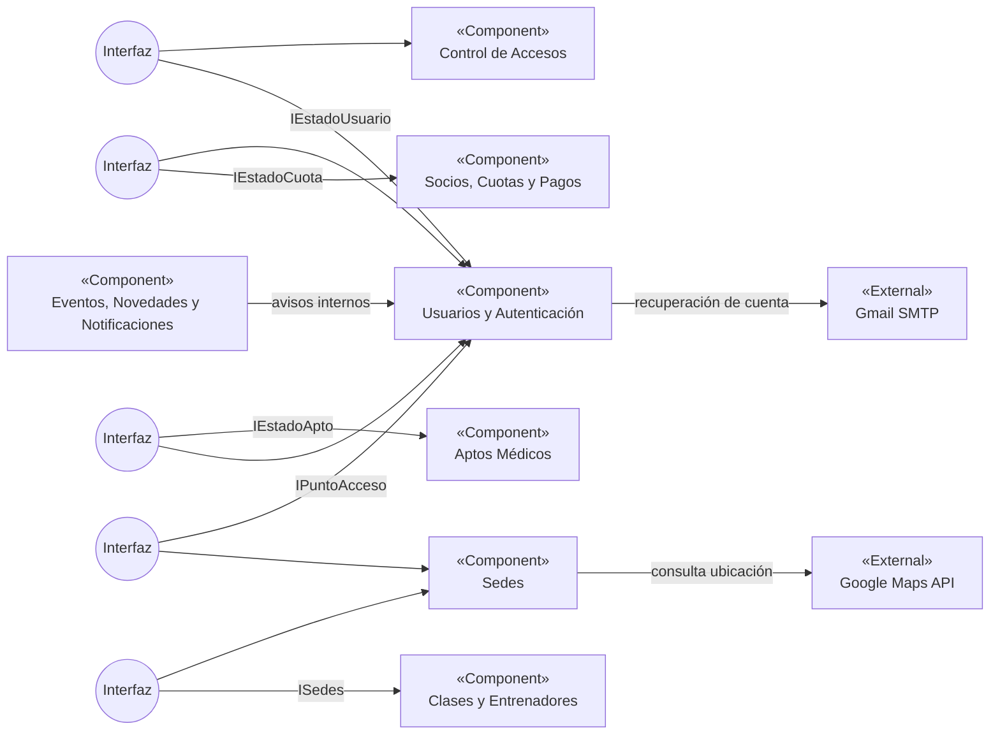

# Diagrama de Componentes — M-Team

> Conversión a Markdown del archivo proporcionado. Aunque el archivo tiene extensión `.pdf`, su contenido corresponde a un diagrama XML de diagrams.net (`mxfile`). Se conservaron los componentes, las conexiones y las etiquetas visibles en el diagrama.

## Diagrama de componentes

**Nota:** Los nodos de «Interfaz» representan conectores de interfaz UML del archivo de origen; las flechas de Mermaid muestran vínculos y no implican necesariamente dirección de invocación o dependencia. No se incluyeron relaciones que no aparecen en el archivo.

## Componentes

| Tipo | Componente |
| --- | --- |
| Componente | Control de Accesos |
| Componente | Usuarios y Autenticación |
| Componente | Socios, Cuotas y Pagos |
| Componente | Aptos Médicos |
| Componente | Sedes |
| Componente | Clases y Entrenadores |
| Componente | Eventos, Novedades y Notificaciones |
| Externo | Google Maps API |
| Externo | Gmail SMTP |

## Interfaces y vínculos identificados

| Origen | Destino | Etiqueta |
| --- | --- | --- |
| Conector de interfaz 18 | Control de Accesos | — |
| Conector de interfaz 18 | Usuarios y Autenticación | `IEstadoUsuario` |
| Conector de interfaz 23 | Usuarios y Autenticación | — |
| Conector de interfaz 23 | Socios, Cuotas y Pagos | `IEstadoCuota` |
| Conector de interfaz 29 | Aptos Médicos | `IEstadoApto` |
| Conector de interfaz 29 | Usuarios y Autenticación | — |
| Conector de interfaz 32 | Usuarios y Autenticación | `IPuntoAcceso` |
| Conector de interfaz 32 | Sedes | — |
| Conector de interfaz 36 | Sedes | — |
| Conector de interfaz 36 | Clases y Entrenadores | `ISedes` |
| Sedes | Google Maps API | consulta ubicación |
| Usuarios y Autenticación | Gmail SMTP | recuperación de cuenta |
| Eventos, Novedades y Notificaciones | Usuarios y Autenticación | avisos internos por usuario |

*El archivo original utiliza la notación visual UML de interfaces proporcionadas/requeridas. Mermaid la representa aquí mediante nodos auxiliares, sin reproducir exactamente su simbología.*
