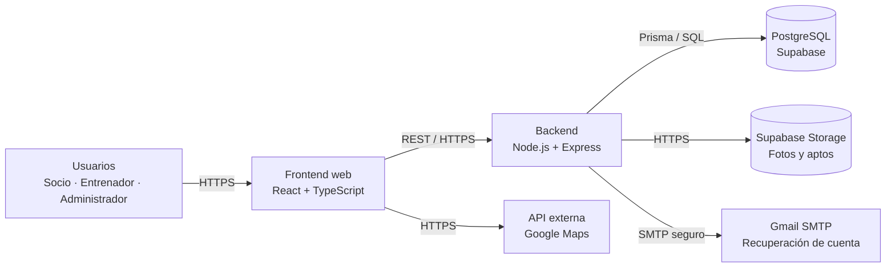

# Diagrama de Arquitectura — M-Team

El frontend consume exclusivamente la API REST. El backend concentra autenticación, autorización, validación, idempotencia, notificaciones y acceso a Storage; PostgreSQL conserva el estado transaccional. Las fotos de perfil utilizan un bucket público separado de los aptos médicos, que requieren acceso privado/firmado. Google Maps y Gmail SMTP son dependencias externas: su configuración productiva debe comprobarse en el ambiente correspondiente.
